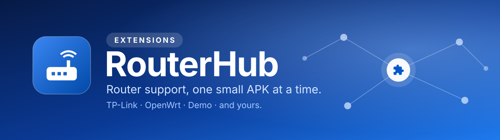
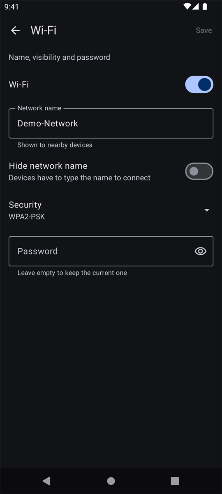

<p align="center">
  
</p>

<p align="center">
  <a href="https://github.com/atasanbratan/routerhub-extensions/actions/workflows/ci.yml"></a>
  <a href="LICENSE"></a>
  <a href="https://github.com/atasanbratan/routerhub"></a>
  
  <a href="CONTRIBUTING.md"></a>
</p>

<p align="center">
  <b>The router support for <a href="https://github.com/atasanbratan/routerhub">RouterHub</a>.</b><br>
  Each extension is a tiny headless APK that teaches the app one router family.<br>
  Your router isn't here yet? It can be, in an afternoon.
</p>

<p align="center">
  <a href="#the-extensions">The extensions</a> ·
  <a href="#install">Install</a> ·
  <a href="#build-and-test">Build</a> ·
  <a href="#add-your-router">Add your router</a> ·
  <a href="#help-wanted">Help wanted</a> ·
  <a href="#how-we-keep-it-safe">Safety</a>
</p>

---

## The extensions

| Extension | Protocols | What it gives you | Status |
|---|---|---|---|
| **[TP-Link ADSL2+](extensions/tplink-adsl)** | Web, Telnet | Status, DSL line stats, connected clients, reboot, and **21 settings pages**: Wi-Fi, security, guest network, MAC and website filters, port forwarding, static routes, DHCP and reservations, Dynamic DNS, DMZ, UPnP, time, log, remote access, SNMP and more | **Verified on real hardware** (TD-W8960N V7) |
| **[Tenda AC](extensions/tenda-ac)** | Web | Status, connected clients, Wi-Fi switch, reboot, and **18 settings pages**: Wi-Fi, guest network, channel and mode, transmit power and WPS, LAN and DHCP, reservations, port forwarding, DMZ, UPnP, firewall, MAC filter, Dynamic DNS, remote management, time, LEDs, scheduled reboot, log, login password | **Verified on real hardware** (AC10 V6.0, firmware V16.03.61.08) |
| **[OpenWrt](extensions/openwrt-ssh)** | SSH | Status, connected clients, Wi-Fi switch, reboot | Unit-tested. **Hardware reports welcome** |
| **[Demo](extensions/demo)** | none | A fake router that lives in memory and shows every field type and the error handling | Try the app with no router. Also the template to copy |

Details: [TP-Link TD-W8960N](docs/tplink-td-w8960n.md) · [OpenWrt](docs/openwrt-ssh.md)

<table>
  <tr>
    <td align="center"><br><sub><b>Installed in the app</b></sub></td>
    <td align="center"><br><sub><b>Forms from a description</b></sub></td>
    <td align="center"><br><sub><b>Editable lists</b></sub></td>
    <td align="center"><br><sub><b>Safeguards that explain</b></sub></td>
  </tr>
</table>

<sub>Shown with the Demo extension, so every name and address is made up.</sub>

## Install

You need the [RouterHub app](https://github.com/atasanbratan/routerhub) first. Extensions are separate APKs
that you install next to it. There are no signed releases yet, so you build from source or take the APKs from CI:

- **From a CI run:** open the latest run of the [CI workflow](https://github.com/atasanbratan/routerhub-extensions/actions/workflows/ci.yml)
  and download the `extensions-debug` artifact.
- **From source:** see [Build and test](#build-and-test).

Install an APK with `adb install -r <file>.apk` or by opening it on the device. Then open the app's
**Browse → Extensions**. An extension signed with the same debug key as your app is shown as a
*Development build* and loads at once. Anything else shows a **Trust** button: the app never loads code from
a signer you have not approved. Finally add a router on the **Routers** tab and pick its firmware.

Not sure where to start? Install the **Demo** extension and add a *Demo router* with any address and password.

## Build and test

```bash
git clone https://github.com/atasanbratan/routerhub-extensions.git
cd routerhub-extensions
./gradlew testDebugUnitTest assembleDebug
```

You need JDK 17+ and the Android SDK (platform 36). The APKs end up in
`extensions/<name>/build/outputs/apk/debug/`.

The extensions compile against `router-api`, the contract that the app publishes through
[JitPack](https://jitpack.io). Gradle fetches it for you. To change `router-api` and an extension together,
check the app repository out next to this one and build with the local copy:

```bash
./gradlew -Prouterhub.sdk=../routerhub testDebugUnitTest
```

## Add your router

1. **Copy the Demo extension.** `extensions/demo` is a complete, working extension with no network code.
   Copy it to `extensions/<vendor>-<family>`, rename the package and the `id`, and add it to `settings.gradle.kts`.
2. **Replace the fake router with real requests.** Keep the parsing in pure functions. The
   [guide to writing an extension](https://github.com/atasanbratan/routerhub/blob/main/docs/writing-an-extension.md)
   walks through the manifest, the contract and the rules.
3. **Test it** against captured pages or command output with all personal data removed, and, if you can,
   against your real router.
4. **Open a pull request.** [CONTRIBUTING.md](CONTRIBUTING.md) has the checklist.

No time to write code? A **[router support request](https://github.com/atasanbratan/routerhub-extensions/issues/new?template=router_support.yml)**
helps: someone else may pick it up.

## Help wanted

- **TP-Link:** more pages (QoS, IPTV, ALG, DNS, backup and restore), a Wi-Fi schedule grid editor, and
  advanced radio settings.
- **OpenWrt:** run it on a real device and tell us what happened. Settings pages for Wi-Fi are the natural next step.
- **Your router.** Anything with a web page, an SSH shell or a Telnet CLI can have an extension.

Browse the [`good first issue`](https://github.com/atasanbratan/routerhub-extensions/labels/good%20first%20issue)
and [`help wanted`](https://github.com/atasanbratan/routerhub-extensions/labels/help%20wanted) labels.

## How we keep it safe

A bad router setting can lock you out of your own network, so extensions follow a few house rules:

- **Validate everything before sending anything.** A bad value never leaves a page half changed.
- **Never replay a write.** If a request may have applied, report it and read the page again.
- **Secrets are write-only.** Passwords and community strings are typed in and never read back.
- **Safeguards beat surprises.** Refuse a change that would lock you out, expose the router or leave a network open.
- **Read the router's refusal.** Many firmwares answer a rejected change with a normal page. Detect it and say why.
- **Test with placeholders.** Captures in the repository have no real SSIDs, MAC addresses or passwords, and
  real-hardware tests are opt-in and restore everything they change.

## Contributing

Every kind of help is welcome: a new extension, a fix, a hardware test report, a doc. Read
[CONTRIBUTING.md](CONTRIBUTING.md) and our [Code of Conduct](CODE_OF_CONDUCT.md). Questions and ideas go to
[Discussions](https://github.com/atasanbratan/routerhub-extensions/discussions). Security problems go to
[SECURITY.md](SECURITY.md).

## Disclaimer

Use at your own risk. Changing router settings can interrupt or lock you out of your network, so keep a way to
reset the device. The TP-Link extension was developed and tested on a single TD-W8960N V7; other models and
firmware revisions may differ. TP-Link, Tenda and OpenWrt are trademarks of their owners. They appear here only to say
what an extension works with, and this project is not affiliated with or endorsed by either.

## License

[Apache License 2.0](LICENSE).
